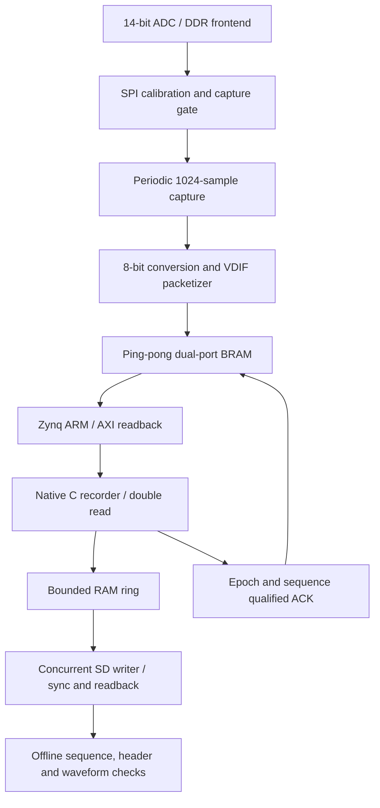

# ADC–VDIF FPGA on Zynq-7000

FPGA and embedded Linux acquisition prototype for the high-altitude balloon lightning-localization instrumentation effort at IIT Kanpur SPARC Lab.

**Latest milestone — 25 November 2026:** CAL9 V3 single-channel periodic diagnostic acquisition demonstrated on physical Red Pitaya hardware. Public RTL and recorder sources are available on main. This is an engineering checkpoint, not a flight-ready or scientific recording release.

## Key results

| Metric | Observed result |
|---|---:|
| Nominal ADC sample clock | 125 MHz |
| Nominal capture rate | 1,000 frames/s |
| Five-minute recording | 299,995 frames |
| Recorded bytes | 316,794,720 |
| Reported skipped captures / errors | 0 / 0 |
| Header, sequence, journal and bank errors | 0 |
| Mean recorder service time | 218.814 µs |
| Service time p99 / maximum | 242.116 / 1,194.706 µs |
| Estimated ring high-water mark | 431 / 32,768 slots |
| Mean 5 MHz sine-fit R² | 0.999648 |
| CAL9 V3 routed setup / hold slack | +0.296 / +0.050 ns |

Results are based on operator-executed hardware and offline verification, not CI runs. Five fewer frames than the nominal 300,000 target were observed; their exact cause is not established. Timing values describe constrained paths, not full electrical sign-off.

## System architecture



Each frame consists of a 32-byte VDIF header and 1,024-byte payload (264 32-bit words). At nominal 125 MSPS, each capture spans 8.192 µs of a 1 ms period, or 0.8192% duty cycle. The recorder acknowledges data after copying to RAM, before durable storage. DMA is not used in the demonstrated CAL9 acquisition.

## Development milestones

| Stage | Evidence and status |
|---|---|
| M1 / M2 | HLS packetization and ADC-to-BRAM integration development |
| M2.5 | ADC-derived frame simulation, AXI readback simulation, synthesis and route |
| M3 (18 Nov) | Physical 5 MHz input, one complete 1,056-byte UDP datagram with matching SHA256; not sustained streaming |
| M4 | Four-channel simulation development; simultaneous physical acquisition not qualified |
| CAL8 / CAL9 | Calibration gating, CDC mailbox, reset handling, periodic capture and bank ownership |
| Native V2 / V3 | RAM-first recording, concurrent writer, ring wraparound and injected writer-failure tests |
| CAL9 V3 (25 Nov) | 10 s, 60 s and 300 s concurrent diagnostic runs; final public source snapshot |

Historical M2.5 constrained timing was WNS +0.270 ns, WHS +0.031 ns, TNS 0; four reported skew constraints met. Its external ADC delays and debug timing were incomplete. These are separate from CAL9 results.

## Repository navigation

| Resource | Location |
|---|---|
| Latest public RTL, XDC, testbench and host software | [CAL9 milestone](milestones/cal9_ch0/) |
| Diagnostic acquisition results | [Engineering report](docs/CAL9_CH0_DIAGNOSTIC_REPORT.md) |
| Exact tested firmware provenance | [Frozen baseline](docs/CAL9_AS_TESTED_BASELINE.md) |
| Historical hardware UDP checkpoint | [M3 verification](docs/M3_CH0_HARDWARE_UDP_VERIFICATION.md) |
| Earlier simulation evidence | [Verification](docs/VERIFICATION.md) |
| Future development | [Roadmap](docs/ROADMAP.md) |
| Contribution and publication rules | [CONTRIBUTING.md](CONTRIBUTING.md) |

## Toolchain and reproducibility

- Red Pitaya STEM 125-14 Z7020 four-input platform; physical PCB revision not independently confirmed.
- AMD Vivado / Vitis HLS 2025.2; XC7Z020-CLG400-1.
- Verilog, SystemVerilog, XDC, C and Python; ARM Linux host recorder.
- Public source checkpoint: `524217b3d6c0dfa9730bd91edebd95e7eaad17e6`, merged into main through PR #1.
- Fresh Git clone of that release: 44 CAL9 files, exact commit and Git integrity verified.
- Exact bitstream, routed checkpoint, debug probes and full engineering dependencies are retained offline. Third-party SPI RTL and packaged HLS IP are withheld pending redistribution clearance. Public project metadata is also incomplete.
- The full local relocated project opened in Vivado 2025.2 without IP upgrades, but twelve module references remained unresolved. A fresh-clone Vivado rebuild has not been qualified.

To inspect the public code:

```sh
git clone https://github.com/SwastikAwasthi25/ADC-VDIF-FPGA-Zynq.git
cd ADC-VDIF-FPGA-Zynq
```

The public repository is **not a standalone buildable Vivado project**. Do not program hardware from an unqualified rebuild. Preserve existing third-party notices; public visibility is not a blanket grant of redistribution rights.

## Qualification boundaries

- **Diagnostic CH0 acquisition:** demonstrated.
- **Scientific recording and flight deployment:** NO-GO.
- **DMA streaming:** HOLD.
- Gapless acquisition, simultaneous physical four-channel capture, calibrated GPS/UTC timestamps and full ADC electrical/CDC sign-off remain unqualified.
- VDIF seconds were zero in the diagnostic recording; scientific timestamp semantics are unqualified.
- Acknowledged RAM frames may be lost on power failure before synchronization.
- Offline waveform checks and matching double reads do not independently prove every ADC sample correct.

The release branch `release/cal9-ch0-diagnostic` preserves the published checkpoint. Earlier M3 source snapshot and M4/DMA development archives are not fully published.
