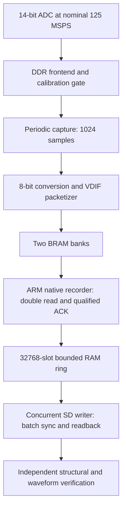

# CAL9 CH0 diagnostic acquisition — engineering verification report

**Date:** 25 November 2026  
**Status:** Diagnostic acquisition PASS; source release and clean-clone build NOT yet qualified.  
**Scope:** Single-channel periodic ADC acquisition on a Zynq-7000 prototype, not a scientific deployment authorization.

## Executive summary
A five-minute nominal 1 kHz periodic acquisition was demonstrated with concurrent storage, without DMA. The reported hardware counters reconcile with 299,995 recorded frames. The operator's independent laptop analysis of the recording verified all frame sequences and headers under the implemented diagnostic checks, and all payloads passed a known 5 MHz waveform sanity test. These are engineering diagnostic results, not a claim of gapless acquisition or fully standards-compliant scientific VDIF.

## Architecture

Each diagnostic frame contains 32 header bytes and 1024 payload bytes. A capture window is nominally 8.192 microseconds per 1 ms period (0.8192% duty cycle). The control path uses bank ownership, sequence-qualified acknowledgement and epoch checks. Data is copied to RAM before acknowledgement; acknowledgement does not imply durable storage.

## Development history
| Stage | Outcome |
|---|---|
| M1/M2/M2.5 | Packetizer and ADC/BRAM integration developed and simulated; see historical repository verification records. |
| M3 | Single-frame physical readback and single UDP datagram demonstration; not sustained streaming. |
| M4 | Four-channel simulation development; no claim of simultaneous physical four-channel qualification. |
| CAL8/CAL9 | Calibration gating, reset/CDC control and periodic ping-pong capture developed. |
| Host acquisition | Python polling and storage overhead motivated native 32-bit MMIO and C recorder. |
| Recovery | After board reset, protected FPGA image restored; clean baseline and normal-mode exit re-established. |
| Native V2 | 10 s and 60 s RAM-first nominal 1 kHz diagnostic runs reported zero skipped windows. |
| Native V3 | Bounded concurrent writer; ARM compilation, ring wraparound and injected writer failure tests passed, followed by 10, 60 and 300 s concurrent runs. |

## Final test results
| Metric | 10 s concurrent | 60 s concurrent | 300 s concurrent |
|---|---:|---:|---:|
| Recorded frames | 9999 | 59999 | 299995 |
| Reported new skips | 0 | 0 | 0 |
| Mean service time (us) | 218.272 | 218.610 | 218.814 |
| Maximum service time (us) | 250.109 | 515.836 | 1194.706 |
| Estimated queue high water (slots) | 338 | 406 | 431 |
| Final pending queue | 0 | 0 | 0 |

Final host duration 300.000005858 s; initial completed count 129997, final 429992, delta 299995; acknowledged, written and synchronized/readback counts each 299995. Reported error counter zero, ready mask zero. File size 316794720 bytes exactly equals frame count times 1056. Five fewer frames than the nominal 300000 target are observed; the exact cause is not established. Zero reported skips does not independently account for every possible nominal window.

## Independent verification
Operator-executed laptop analysis reported all three original file hashes matching, zero header/sequence/journal/bank-alternation errors, sequences 129997–429991, 307194880 payload samples, signed code range -24 to 21, zero endpoint-code clipping. Bank 0: 149997 frames; bank 1: 149998 frames. All frames had dominant FFT bin 41 and R² at least 0.99 when fitted to a nominal 5 MHz sinusoid.

| Waveform metric | Min | Mean | Max |
|---|---:|---:|---:|
| FFT interpolated estimate (Hz) | 4998941.055 | 4999673.255 | 5000608.225 |
| Peak amplitude (8-bit LSB) | 21.95996 | 22.05866 | 22.18716 |
| R² | 0.99942507 | 0.99964800 | 0.99978960 |
| RMS residual (LSB) | 0.22585 | 0.29006 | 0.37434 |

Service p99 242.116 us; two service times exceeded 1000 us; host observation intervals reached 2626.583 us. No hard real-time guarantee follows. Frequency estimates assume nominal sample clock; interpolation is not calibrated metrology. A known waveform sanity check and double-read equality do not independently prove every ADC sample correct.

## Evidence and reproducibility
Results above are transcribed from operator-provided terminal outputs, not a new execution in GitHub. The original recordings, logs, waveform JSON, native sources, executable and 12-file manifest remain on the workstation. This report does not include raw research data or lab-owned sources. Publication review and exact dependency export are required before distributing them.

## Release boundaries
- Scientific deployment: NO-GO.
- DMA: HOLD.
- No gapless 125 MSPS recording, calibrated UTC/PPS time or simultaneous physical four-channel qualification demonstrated.
- VDIF seconds field was zero across the recorded frames; standard scientific timestamp semantics remain unqualified.
- Full electrical/CDC qualification and board revision confirmation remain open.
- Power loss before storage synchronization can lose acknowledged RAM frames.
- Clean-clone build and compatible hardware reproduction have not been demonstrated.

## Acceptance for a future source release
Export exact active RTL, HLS sources or legally redistributable packaged IP, BD creation Tcl, constraints, IP versions, testbenches and vectors, host utilities and analysis scripts; resolve all machine-specific paths; build in a separate clean clone with Vivado/Vitis HLS 2025.2 and appropriate ARM Linux tooling; run regressions and independently review timing and artifacts before tagging. Hardware programming requires compatible board and operator approval.
